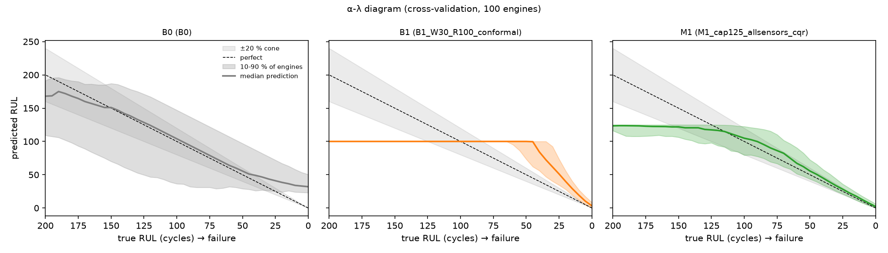

# Turbofan RUL Prognostics

**Remaining Useful Life (RUL) prediction for turbofan engines, with calibrated uncertainty and a
maintenance decision rule — NASA C-MAPSS FD001.**

At every operating cycle, the models estimate how many cycles an engine has left before failure,
give a 90 % prediction interval, and turn it into a decision: *schedule maintenance now, or wait?*


---

## Key results

Single, locked evaluation on the 100 NASA test engines (95 % bootstrap confidence intervals):

| Model | RMSE (cycles) | C-MAPSS score ↓ | Interval coverage¹ | α-λ accuracy (±20 %) |
|---|---|---|---|---|
| B0 — population prior, no sensors | 36.1 [31.7, 40.5] | 7 474 | 93 % | 31 % |
| B1 — health indicator + linear degradation | 25.0 [22.1, 27.9] | 2 050 | 97 % | 43 % |
| **M1 — LightGBM quantile + conformal (CQR)** | **14.5 [12.2, 16.6]** | **301** | 91 % | **72 %** |

¹ 90 % interval, on engines whose true RUL is within the model's cap.

**Decision impact** (cross-validation, full trajectories, 20-cycle logistics lead time):

| Decision based on | Failures / 100 engines | Useful life lost per engine |
|---|---|---|
| **Lower bound (q05) of M1** | **0** | 14.3 cycles |
| Median prediction of M1 | 48 | 4.1 cycles |

> Deciding on the median means a one-in-two chance of acting too late. Deciding on the calibrated
> lower bound avoids every failure for about 14 cycles of margin per engine.

---

## Approach

| | Model | Idea |
|---|---|---|
| **B0** | Population prior | Median remaining life of training engines that survived to the same age. No sensors — the floor any model must beat. |
| **B1** | Health indicator + linear degradation | Fuse the monotone sensors into a 1 → 0 health indicator, fit a line on the last 30 cycles, extrapolate to the failure threshold. |
| **M1** | Gradient boosting | LightGBM quantile regression (q05 / q50 / q95) on strictly causal rolling features; target capped at 125 cycles; intervals calibrated by conformalized quantile regression. |

**Why cap the target?** Degradation is invisible for most of an engine's life and accelerates over
the last 100–150 cycles. Far from failure, an engine with 300 cycles left looks exactly like one
with 200 — learning that difference means learning noise. Capping improves RMSE by 4.7 ± 3.2 cycles
(5/5 folds).

The baseline, six testable hypotheses, the validation protocol and the decision rule were written
in [`HYPOTHESIS.md`](HYPOTHESIS.md) **before any model was fitted**; every later
change is logged there with its date and reason.



*α-λ diagram (cross-validation): median prediction and 10–90 % band versus true RUL; grey cone =
±20 %. M1 enters the cone about 100 cycles before failure; B1 lags behind (late, unsafe side).*

---

## Leak-free validation

| Leakage risk | Safeguard |
|---|---|
| Random split | 5-fold `GroupKFold` **by engine** — no engine in both train and validation (asserted) |
| Non-causal features | Right-aligned per-engine windows only; automatic truncation test blocks the run if any feature changes when the future is removed |
| Global preprocessing | Sensor selection, scaling, health indicator, threshold, models and conformal calibration all refitted **inside each fold** |
| Target leakage | RUL and lifetime never used as inputs |
| Test-set reuse | NASA test set evaluated **once**, protected by a hashed lock ([`reports/TEST_LOCK`](reports/TEST_LOCK)) |

Test censoring is reproduced in validation by cutting each validation engine at 5 fixed random
points. Model selection uses RMSE in the *decision zone* (true RUL ≤ 150), fixed before any result.

Additional checks: perturbing an engine's future cycles leaves all past predictions unchanged
(difference 0.0); scrambling failure times across engines raises M1's RMSE from 12.8 to 35.0.

---

## Quick start

**Requirements:** Python 3.14 and `make`.

**1. Get the data.** The raw NASA files are not versioned. Download the C-MAPSS archive from
<https://data.nasa.gov/dataset/c-mapss-aircraft-engine-simulator-data> and place these files in
`CMAPSSData/`:

| File | SHA-256 |
|---|---|
| `train_FD001.txt` | `963b5e22825b34d8b21c69e1aeb4af3e647050eb672ee8834ba4b5d91d2de0f8` |
| `test_FD001.txt` | `3cda7109ce17bafb5443f2ac926cfcf88154b941b8c4cf95eb55d1ddd6f52851` |
| `RUL_FD001.txt` | `a19c8ec94931949d0485bdc35118206e9c81c4547b422efb9cf86f4ceddbceca` |

```bash
sha256sum CMAPSSData/*_FD001.txt   # verify the download
```

**2. Run.**

```bash
make setup     # create .venv and install pinned dependencies
make all       # diagnostic → cross-validation → decision → test   (~6.5 min, seed 42)
```

Results are deterministic: a fresh clone reproduces every report and prediction byte for byte.
The test step replays the original locked evaluation and refuses to run if the frozen
configuration in `src/frozen.py` has been modified.

---

## Repository structure

```
├── src/
│   ├── data.py          # loaders for the raw NASA files
│   ├── diagnostic.py    # Phase 1 — data diagnostic
│   ├── features.py      # strictly causal per-engine features + causality check
│   ├── models.py        # B0, B1, M1 (LightGBM quantile + CQR)
│   ├── metrics.py       # RMSE, C-MAPSS score, coverage, α-λ
│   ├── cv.py            # Phase 2 — GroupKFold cross-validation + ablation
│   ├── decision.py      # Phase 3a — α-λ diagram + maintenance decision simulation
│   ├── frozen.py        # configurations frozen after cross-validation (hashed)
│   └── test_eval.py     # Phase 3b — single locked evaluation on the test set
├── reports/             # generated reports, figures and TEST_LOCK
├── HYPOTHESIS.md        # pre-registered baseline, hypotheses, protocol, change log
├── Makefile
└── requirements.txt     # pinned dependencies
```

| Report | Content |
|---|---|
| [`reports/diagnostic.md`](reports/diagnostic.md) | grid, duplicates, missing values, constant sensors, trends, outliers |
| [`reports/cv_results.md`](reports/cv_results.md) | baselines, cap and feature ablation, interval calibration, error by RUL range |
| [`reports/decision_cv.md`](reports/decision_cv.md) | α-λ accuracy, decision rule, lead-time sensitivity |
| [`reports/test_results.md`](reports/test_results.md) | final test metrics with bootstrap CIs and test-time decisions |
